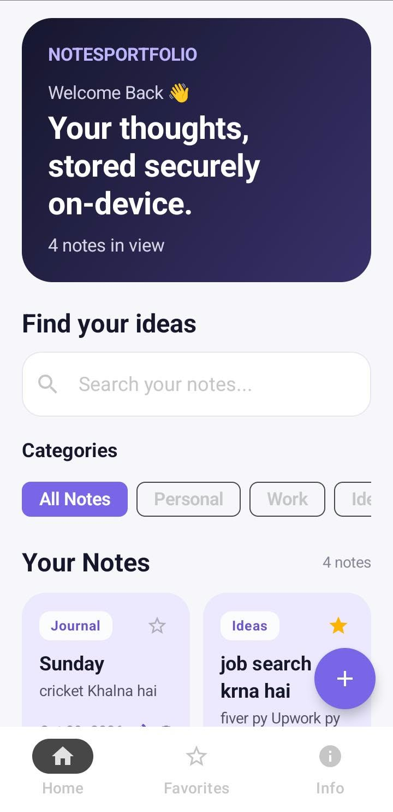
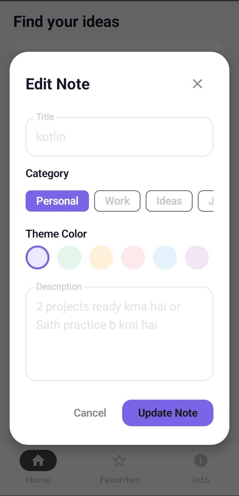
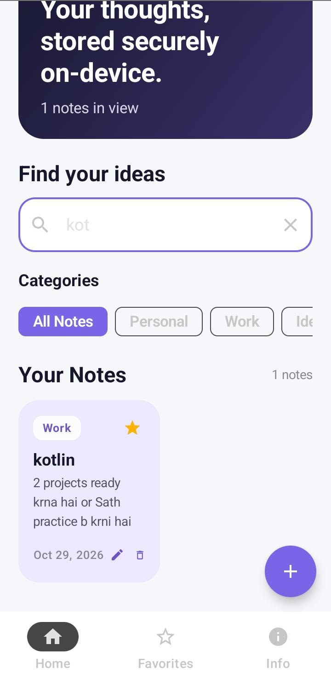

# NotesPortfolio 📝

A Notes application built with **Kotlin, Jetpack Compose, MVVM, and Room Database**.

## Features

- Create new notes
- Edit existing notes
- Delete notes
- Search notes
- Store notes locally using Room Database
- Modern Android UI built with Jetpack Compose

## Tech Stack

- **Language:** Kotlin
- **UI:** Jetpack Compose
- **Architecture:** MVVM
- **Local Database:** Room
- **Asynchronous Operations:** Kotlin Coroutines
- **Build System:** Gradle with Kotlin DSL

## Architecture

The project follows the MVVM architecture and separates responsibilities into different layers:

- **UI:** Displays notes and handles user interactions.
- **ViewModel:** Manages UI state and application logic.
- **Repository:** Connects the ViewModel to the data source.
- **Local Data:** Room Database, Entity, and DAO manage persistent note storage.

## Package Structure

```text
com.irshadkasiri.notesportfolio
├── data
│   ├── local
│   │   ├── NoteDao.kt
│   │   ├── NoteDatabase.kt
│   │   └── NoteEntity.kt
│   └── repository
│       └── NoteRepository.kt
└── ui
    ├── NoteViewModel.kt
    ├── components
    │   ├── AddEditNoteDialog.kt
    │   └── NoteCard.kt
    └── theme
```

## Getting Started

1. Clone this repository:

   ```bash
   git clone https://github.com/irshadkasiri/NotesPortfolio.git
   ```

2. Open the project in Android Studio.
3. Allow Gradle to sync.
4. Run the app on an Android emulator or a connected Android device.

## Author

**Irshad Kasiri**

GitHub: [@irshadkasiri](https://github.com/irshadkasiri)

---

Built as an Android development portfolio project.

## Screenshots

### Home Screen


### Edit Note


### Search Notes


